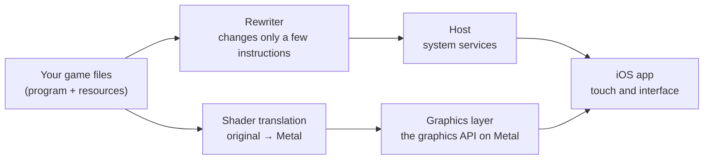

# D2R Mobile

**An open-source iOS / macOS compatibility layer for Diablo II: Resurrected with the Reign of the Warlock expansion.** It brings the Nintendo Switch release you bought, expansion included, to iPhone, iPad and Mac in full: the original game code runs natively, every control is rebuilt for touch, the frame rate holds at 60 fps, and you are in a game one second after the main menu. There is now a native macOS version as well (first version): on an Apple silicon Mac it starts on double-click and works with keyboard, mouse and gamepad.

This is not a tech demo that "sort of runs". It is a mobile version polished for daily play, from your first character all the way through the endgame.

Platforms: iPhone / iPad (iOS 26 and later; iOS 18 – 25 with the older-API build) · Mac (Apple silicon, macOS 26 or later; macOS 15 – 25 with the older-API build) · Game version: Switch release with Reign of the Warlock, 1.0.34.0 (corresponds to PC version 3.3.94012) · English / 中文 · License: MIT · **Bring your own game files**

中文: [README.zh-CN.md](README.zh-CN.md)

<p align="center">
  
</p>
<p align="center">
  
  
</p>

| Locked 60 fps | 10 h battery | 1-tap Runewords | 100-level Greater Rift | Uber Boss Rush | 1 s to play |
|:---:|:---:|:---:|:---:|:---:|:---:|
| No drops once the phone warms up | Per charge, in power saver mode | Long-press a base, socket every rune | Skill cap rises from 20 to 40 | 12 stages, Diablo Clone to the Ubers | From the main menu into a game |

## Build it with one sentence

Have your game files ready, then tell Claude Code or Codex:

```
Use the d2r-mobile skill from https://github.com/d2r-mobile/d2r-mobile to build D2R Mobile for my iPhone. My game files are in <path>.
```

The agent checks your machine, prepares the workspace, signs and installs the app, and copies the game resources to your phone. It stops to ask you for your Apple signing details and before any install that needs `sudo`. The skill lives at [skills/d2r-mobile/SKILL.md](skills/d2r-mobile/SKILL.md), and both agents find it on their own through `.claude/skills/` and `.agents/skills/`. The manual steps are under [Getting started](#getting-started).

## Why it plays like a native game

- **Your phone runs the original program.** iPhone and Switch use the same family of ARM processors. The rewriter changes only the instructions Apple's kernel rejects (thread-pointer registers, system calls, timers) and leaves every other byte as shipped. Classes, Runewords, Terror Zones, bosses, drop rules and quests match the original because they are the original code.
- **Graphics go straight to Metal.** A small host written for Apple platforms provides the system calls, files, audio and input the game expects, and reimplements its graphics API on Metal. The build translates every shader offline, so you never wait on a shader compile when you enter a new area.
- **Older chips get their own textures.** A16 and earlier chips lack the game's compressed texture format. The build adds a supplementary texture pack for them, and those phones hold 60 fps too.

## What ships, and what you bring

The repository ships the rewriter, the host, the graphics layer, the iOS app, the test tooling and the full build pipeline. It ships no game program, art, text, data tables or shaders: your own machine generates all of that from your own files (see [docs/GAME_FILES.md](docs/GAME_FILES.md)). The interface details we recorded to make the port work, such as shader interface descriptions, the graphics API function table and addresses inside the program, are listed item by item in [docs/DERIVED.md](docs/DERIVED.md).

The game runs fully offline and needs no online account. Multiplayer is out of scope.

## Battle-tested

All **44** iPhones and iPads in the closed beta **cleared Normal, Nightmare and Hell with several characters**: 35 registered devices (25 iPhones and 10 iPads) plus 9 TestFlight accounts with one device each. The oldest, an iPhone 14 Pro Max with 6 GB of memory, holds 60 fps.

| | Models |
|---|---|
| iPhone | 14 Pro Max, 15, 15 Pro, 15 Pro Max, 16 Plus, 16 Pro, 16 Pro Max, 17 Pro Max and more |
| iPad | iPad Air, iPad mini, iPad Pro 11-inch and 12.9 / 13-inch (including M2 and M4) and more |
| Lowest model tested | **iPhone 14 Pro Max (A16, 6 GB): a steady 60 fps** |

One install package covers iPhone and iPad.

<p align="center">
  
  
  
  
  
</p>

## Speed and battery

Measured on an iPhone 17 Pro Max:

| Item | Reading |
|---|---|
| In-game frame rate | **60 fps**, steady, with no drops once the device warms up |
| App launch | 0.15 s |
| To the main menu | about 1 s |
| From the main menu into a game | **about 1 s** |
| Quick Restart, back in a game | about 1.2 s |
| Longest frame when changing acts | about 0.1 s |
| Whole-device power, 60 fps | **about 3.8 W** (in camp, 50% brightness): close to 5 hours of play on a full charge |
| Whole-device power, power saver mode at 30 fps | **about 1.85 W**: close to 10 hours of play on a full charge |

<sub>Measurement conditions: whole-device power measured on 2026-10-10 on an iPhone 17 Pro Max, standing in the Act I camp at 50% brightness, with 60 fps and power saver mode measured in the same scene. Battery life comes from the measured power and the battery capacity, not from playing a full charge down to empty. Launch and game-entry times were measured on the same model in 2026-10; frame rate and act-change readings were taken on the same model on 2026-10-12 while moving through areas and changing acts.</sub>

The install package is a little over 100 MB. The game resources (about 5.6 GB) go onto the phone separately, and app updates leave your saves and resources alone.

Why it is this fast: the program executes natively, and not a single instruction goes through emulation; graphics go straight to Metal; every shader is translated offline and compiled ahead of time, so nothing is compiled when you enter a new scene. Older chips (A16 and earlier, such as the iPhone 14 family and iPhone 15) do not support the game's original compressed texture format; they need an extra texture pack made from your own game files, and then run at full frame rate too — see [docs/LEGACY_DEVICES.md](docs/LEGACY_DEVICES.md).

We rebuilt every panel and every action for touch, with one rule: **keep the original interface language, and use gestures in place of extra buttons**. Text and tap targets are sized for fingers. You can play the moment you pick it up, and long sessions stay comfortable.

<p align="center">
  
  
</p>

- **Move**: a virtual stick with precise diagonals. Tap an NPC or the ground to walk there. Doors, portals and cave entrances respond to a tap anywhere on their surface.
- **Fight**: press a skill button to cast, hold to keep casting, and **drag to aim at any angle**; nearby monsters get targeted for you. You get two skill sets. Skills on your secondary weapons cast with one tap: the game swaps weapons, casts and swaps back, and the button shows the charges left.
- **Boss health bar**: pinned to the top of the screen with the percentage remaining.
- **Items**: tap, double-tap, long-press and drag and drop all follow your finger. Double-tap gear to equip or unequip it. Drag an item anywhere onto the vendor panel to sell it. On a stack, double-tap takes 1 and long-press takes 3. Long-press an empty inventory slot to sort everything.
- **Text**: you type with the system keyboard. Character names can be in Chinese; leave the name blank for a random one.
- **Screen**: on iPhone the game fills the 19.5:9 display edge to edge, clear of the notch and rounded corners. On iPad it fills the whole screen, and the interface centers itself when you open a panel. You can brighten the 3D picture.

### Controller

Connect a controller and press any button: the interface switches to the original controller layout, with button prompts at the bottom of every panel. Touch the screen and the touch interface comes back. Inventory, stash, skill tree, Chronicle and settings all work with a controller, using the Switch button mapping.

<p align="center">
  
  
</p>

## Endgame on top of the original

Clear Hell and a new endgame opens up. None of it changes the original rules.

### Greater Rift

Enter through the red portal in Harrogath. The Rift has 100 levels, and the monsters grow stronger on each one. Fill the progress bar and kill the Rift Guardian within 15 minutes to clear a level. Every 2 levels grant +1 Skill Point and +5 Stat Points, and the skill level cap rises from 20 to 40. Every 10th level has a first-clear reward, and clearing level 10 unlocks six new equipment slots for your mercenary.

<p align="center">
  
  
</p>

### Boss Rush, Elysium mode and the Kill Board

- **Endgame Boss Rush**: 12 stages after you clear Hell. Stage 11 is Diablo Clone, and stage 12 is the three Uber bosses.
- **Elysium mode** (you choose it at character creation): Unique ×5, Set ×3, Runes ×5. The "no drop" chance falls to a tenth, and every boss kill drops like a first kill.
- **Kill Board**: for every boss, your kill count, the time of your first kill, the Unique and Set items it has dropped, and your best and average kill times.

<p align="center">
  
  
</p>

### Storage for collectors

- **Chronicle stash**: every identified Unique and Set item has its own fixed slot, shared by all your characters, with search, deposit and withdraw. The Deposit button sends the Unique and Set items in your inventory and Horadric Cube there in one tap.
- **Stash**: 14 columns wide, with 5 personal pages and 5 shared pages.
- **Trove**: the gem, rune and material pages merged into one, with the Horadric Cube's crafting grid in the middle, so you find and craft on one page. Runes, gems and materials you put into the personal or shared pages get filed here for you.
- **Pouch**: an extended inventory. Runes and gems you find in the field go into it and take up no inventory space.

<p align="center">
  
  
</p>

### Less busywork while you farm

| | |
|---|---|
| Runeword helper | Long-press a socketed base to list the Runewords it can make and their stats. Once you have the runes, socket them all in one tap |
| Auto-recast buffs | Your learned buffs need no slot on the skill bar. When a buff runs out, the game recasts it the moment you stand still. Buffs from your secondary weapons (such as Battle Orders from Call to Arms) swap weapons, recast and swap back |
| Potions and belt | Auto-drink has two tiers: a healing potion below 50% Life, a rejuvenation potion below 30%. **Your mercenary drinks by the same rule.** You pick up potions on the ground when the belt has room, and a double-tap on an empty belt slot refills the whole belt |
| Loot filter | From Nightmare on, the original loot filter switches on to hide clutter: light filtering in Nightmare, heavy in Hell |
| Auto-pickup | Low runes and gems go straight into the Pouch; you pick up the high ones yourself |
| Valuable drop alerts | High runes and Unique items raise a light beam and land with their own sound. The phone vibrates light, medium or heavy according to value |
| Minimap guidance | Every map marks its Waypoint and exits, and every quest goal sits on the map. When a target is off screen, its name runs along the screen edge |
| Chores removed | Free identification, free Town Portal with no scrolls, spawning beside the Waypoint, Quick Restart, refreshable vendor stock |
| Saves | The game saves the moment you switch apps, swipe the app away or quit. iCloud syncs your saves across devices (requires signing with a paid developer account) |

You can toggle most features one by one in game under Options → Custom.

<p align="center">
  
  
  
</p>

### English and Chinese

Switch the whole game between English and Chinese under Options → Custom; after a restart, the interface and the voice acting use the language you chose. In English, items, skills and monsters keep the original Diablo II wording, and everything we added (Greater Rift, Chronicle, the settings page, controller prompts) has English text too.

<p align="center">
  
  
</p>

## How it works



| Part | Where | What it does |
|---|---|---|
| Program rewriter | `dm/tools/patch_nso.py` | Rewrites only the few instructions that cannot run unchanged under Apple's kernel (thread-pointer registers, system calls, timers) and leaves the rest of the program byte for byte as shipped |
| Host | `dm/host` | Loads the rewritten program and provides the platform services it calls |
| Graphics | `dm/gfx` | Implements the game's graphics API on Metal; the build translates shaders offline from the game's originals |
| iOS app | `dm/ios` | The app shell, touch controls and interface |
| Verification | `dm/verify` | Checks that the rewritten code behaves like the original, plus the regression gates every change goes through |

**Tests ship with the code.** The project includes unit tests for the host and graphics layers, an equivalence check for every rewritten instruction, scripted walkthrough regression for the touch interface, and on-device smoke tests. Start with `make -C dm/host/tests run`, `make -C dm/gfx/tests run` and `dm/verify/regress.sh` (run them inside the Python environment from step 2 below; `regress.sh` also needs `brew install llvm`). [CONTRIBUTING.md](CONTRIBUTING.md) covers how to send changes.

## Which devices are supported

| Device | Playable? | How | How sure we are |
|---|---|---|---|
| **iPhone / iPad, A17 Pro and later** (iPhone 15 Pro and later, iPhone 16 and later, iPads with M-series chips) | Yes | iOS 26 or later: the default shell / default build; iOS 18 – 25: the iOS 18 shell / [older-API build](docs/OLDER_SYSTEMS.md) | Main devices, played daily |
| **iPhone / iPad, A16 and earlier** (all iPhone 14 models, iPhone 15 / 15 Plus, iPhone 13 series and so on) | Yes, with one extra step | Make a Legacy Device Pack from your own game files as in [docs/LEGACY_DEVICES.md](docs/LEGACY_DEVICES.md) and include it when making the install package; the system split is the same as the row above | Played by players: iPhone 14 Pro Max (A16, 6 GB) at 60 fps; iPhone 13 Pro Max (A15, 6 GB) in the 30 fps mode |
| **Devices with 4 GB of RAM** (such as the 4th-generation iPad Air) | Not supported yet (we are reducing memory use and will update this when there is progress) | — | Tested by a player: on an iPad Air 4 (A14, 4 GB) with the Legacy Device Pack, the system ends the app a few seconds after launch because the device runs out of memory |
| **Chips older than A15 with 6 GB of RAM or more** | No reports yet | Same as the A16-and-earlier row | If you have tried, please open an Issue and tell us |
| **Mac, Apple silicon** | Yes (native macOS App) | macOS 26 or later: the default build; macOS 15 – 25: the [older-API build](docs/OLDER_SYSTEMS.md). Keyboard, mouse and gamepad all work; what each can do is in [docs/MAC.md](docs/MAC.md) | A player has played the older-API build on macOS 15.7.7 |
| **Intel Macs** | Not supported | — | — |

**What the dialogs in the App mean**

- **"One More Step for This Device"**: this phone can run the game; the install package was made without the Legacy Device Pack. Make the pack as in [docs/LEGACY_DEVICES.md](docs/LEGACY_DEVICES.md), make the install package again with it and reinstall.
- **"Device Not Supported … iPhone 15 Pro and later can play"**: this is the old text from before v1.0.9. You are on an old version; update to the latest. For A16 and earlier devices, then follow the line above.

**What a package you build yourself does not have, compared with our test-group builds**: the public version can be built and installed with a free Apple ID. Three things in our test-group builds are not in it: iCloud save sync (the App needs the iCloud signing entitlement, which a self-signed package does not have), downloading packs and resources inside the App, and new-version notices (these two use our own server). The game itself and the features we added are the same.

## Getting started

Both routes start with **the files of the game you bought**: the Switch release of Diablo II: Resurrected plus the Reign of the Warlock expansion, updated to 1.0.34.0 (the version the console shows; it corresponds to PC version 3.3.94012, and the directory names and tools in this repository use the latter number). This project is built for the version with that expansion; using it without the expansion is not supported and has not been verified. How to prepare them is in [docs/GAME_FILES.md](docs/GAME_FILES.md).

> This project provides only tools and an install shell that contains no game content. We do not distribute or endorse, and are not responsible for, any third party distributing game assets, game executables or install packages that contain game content. Please use only game files you legally own.

This project is implemented and verified on the Switch release 1.0.34.0 (which corresponds to PC version 3.3.94012), and by default the tools accept only that version. Community users have reported adapting other versions on their own by following the structure of this repository, and running them successfully. The rule tables are grouped by game version (in `dm/tools/patch_nso.py`, keyed by the build ID of the main program); you are welcome to contribute the version you adapted.

**Check your device first**: the "Which devices are supported" table above tells you which build to use and whether you also need a Legacy Device Pack.

| | With a Mac | Without a Mac |
|---|---|---|
| Computer | An Apple silicon Mac with Xcode installed | Windows / Linux / a Mac without Xcode |
| Method | A full build from source | Download a "shell" with no game content, add your own game content with the packaging tool, then install it with a sideloading tool |
| Status | The main route; every number above comes from it | Works end to end on Windows, from making the package to playing on a device, and both systems produce a byte-identical game program. Nobody has tried signing with a sideloading tool yet: try it and tell us |
| Instructions | The three steps below | [docs/NO_XCODE.md](docs/NO_XCODE.md) |

The Apple account you sign with: a paid developer account gives you everything. A free Apple ID works too, without iCloud save sync, and you re-sign and reinstall the app every 7 days. [docs/DEPENDENCIES.md](docs/DEPENDENCIES.md) lists every dependency.

The fastest route is [the one-sentence build](#build-it-with-one-sentence): your agent runs the steps below for you.

### With a Mac: three steps

1. Put your game files in the workspace (default `~/dm-work`, or set `DM_ROOT`):

   ```
   ~/dm-work/data/switch/3.3.94012/Update/ExeFS/    main, sdk, subsdk0
   ~/dm-work/data/switch/3.3.94012/Update/RomFS/    data/…
   ```

2. Prepare the workspace. This checks your tools, rewrites the game program, and translates the game's shaders to Metal. The first run takes about 11 minutes; later runs skip finished steps.

   ```
   ./setup.sh
   source ~/dm-work/build/cache/dm/venv/bin/activate     # run everything after this inside the Python environment setup prepared; if you changed DM_ROOT, use it in place of ~/dm-work
   ```

3. Fill in your signing details and build the app:

   ```
   cp dm/ios/local.env.example dm/ios/local.env     # set DM_TEAM_ID and DM_BUNDLE_ID; with a free Apple ID also set DM_FREE_ACCOUNT=1 and DM_IOS_UDID, and keep the phone connected while building
   cd dm/ios && ./run.sh build    # targets both iPhone and iPad by default; for iPhone only: DM_DEVICE_FAMILY=1 ./run.sh build
   ```

The first time you open the app on your phone, it asks for the "game resource folder": the 18 resource archives from your game files. The section "The "game resource folder" that goes on the phone" in [docs/GAME_FILES.md](docs/GAME_FILES.md) shows where to put them.

`./setup.sh check` is a health check. It reports the state of this computer, the tools, the game files and the signing configuration item by item, and for anything missing it says where to get it and which command to run next. It changes nothing. If you have a whole game package (`.xci` / `.nsp`), `./setup.sh <game package> <prod.keys>` extracts the game files into place first and then carries on (install hactool first). Run `./setup.sh` again after you pull new commits: it rebuilds the patched binaries and the shader library for the current sources and skips steps that are up to date. It also rewrites three files in the repository that track your local tool fingerprints (`dm/gfx/tools/dmsh_chain.lock`, `dm/gfx/nvn/dmsh_chain.h`, `dm/gfx/nvn/c1_full.tsv`). That is expected; do not commit them.

### Playing directly on a Mac

After the same `./setup.sh`, one more command builds a native macOS App that starts on double-click and works with keyboard, mouse and gamepad, with no developer account:

```bash
source ~/dm-work/build/cache/dm/venv/bin/activate
dm/tools/mac_app.sh                  # macOS 26 or later: produces ~/dm-work/out/macapp/D2R Mobile.app
DM_MAC_M3=1 dm/tools/mac_app.sh      # macOS 15 – 25: produces D2R Mobile M3.app
```

The interface is the original's gamepad interface. Keyboard: Space confirms, Esc goes back, Return, the `=` key opens the menu / a new character, W A S D moves, and every other gamepad button has a key. Mouse: clicking a monster, NPC or object walks over and interacts, and the skill slots, potion cells and key hints at the bottom, buttons and tabs in panels, the class figures when creating a character and the minimap can all be clicked; clicking empty ground walks there and holding keeps walking, clicking a monster attacks it, and items take double clicks and drags. With a keyboard, the prompts on screen show keyboard keys. Saves stay on this Mac (an App you build yourself has no iCloud sync) and can be imported by hand from an iPhone / iPad. The key table, how to create a character, what the mouse can do, the import steps and the known shortcomings are in [docs/MAC.md](docs/MAC.md). Keyboard and a physical gamepad have not been operated by a person yet — if you try it, please tell us how it went.

### Without a Mac: the shell plus the packaging tool

Download our prebuilt "shell" package (`D2RMobile-shell.ipa`; `D2RMobile-shell-ios18.ipa` for iOS 18 – 25), which contains no game content, from this repository's [Releases page](https://github.com/d2r-mobile/d2r-mobile/releases), add your own game files, make the install package on Windows or Linux, then sign and install it with a sideloading tool. On this route only, because the computer making the package has no Apple shader compiler, the **first launch** on the phone spends about 7 minutes compiling shaders (once, with a progress bar); a package built with Xcode has no such step. The steps, and how far each one has been verified, are in [docs/NO_XCODE.md](docs/NO_XCODE.md).

## Known limitations

| Item | Status |
|---|---|
| Online play | Out of scope; fully offline |
| `.nsp` / `.xci` game packages | The tools only check the version of the main program and do not distinguish package formats; we ran the whole path with an `.xci` ourselves, and users have reported that `.nsp` packages work perfectly as well |
| Signing and installing with a sideloading tool (Sideloadly, AltStore and the like) | Not verified; open an issue and tell us how it went |
| Making the package on Linux | Not verified (verified on Windows and Mac) |
| Devices that have not moved to iOS 26 / macOS 26 | Playable with the older-API build (minimum iOS 18.0 / macOS 15.0): [docs/OLDER_SYSTEMS.md](docs/OLDER_SYSTEMS.md); the full device table is under "Which devices are supported" above |
| A16 and earlier devices (iPhone 14 family, iPhone 15 / 15 Plus and so on) | Playable; they need a Legacy Device Pack and an App built with it: [docs/LEGACY_DEVICES.md](docs/LEGACY_DEVICES.md). "One More Step for This Device" (older versions say "Device Not Supported") in the App means this step is missing |
| The "one-line verdict" and "legacy Chinese name" entries in item notes | These two content tables are not shipped with the repository; you can supply your own, see `dm/ios/tools/annot/README.md` |

## Contributing and feedback

- If you hit a problem, open an issue (there is a template). The file from Share Diagnostics in the pause menu helps the most.
- For the items marked not verified, tell us whether they worked. Either answer helps.
- To change the code, get the test entry points above passing first. Every change has to pass the regression gates.

**Taking it to other platforms:** this approach is not limited to iPhone and iPad. Apple silicon Macs already have a native version (see "Playing directly on a Mac" above), built from the same game program and the same host. Android phones use the same class of processor, so the game program executes natively there as well, and the route is fully open: the only parts to replace are the sides of the host and the graphics layer that face the platform. The author has no Android phone at hand, and would love to see someone bring it to Android.

**Taking it to other games:** someone has already tried other Switch games on the same host. The host has some behaviour that is on by default on iOS and was written for this one game; another game runs into these first, so turn them off or move them out before you start:

- `dm/host/hle_oe.c`: the 3D render scale defaults to 0.75 on iOS, and `scale3d_tick` rewrites it at offsets inside this game's renderer — with another game that is a wild pointer.
- `dm/host/hle_fs.c`: seeding the shared stash on first launch (`DM_STASH_SEED`) and the touch-layout default settings (`DM_TOUCH_DEFAULTS`) are on by default on iOS.
- `dm/host/main.c`: the save-flush throttle patches a constant at a fixed address in the game program; `argv[0]` is hard-coded to `"D2R"`.
- `dm/host/hle_time.c`: the fixed-time test switch recognises a fixed address in the game program.
- `front_game_res` in `dm/host/front_mac.m`: the docked / handheld resolutions are hard-coded to 1600×900 / 1280×720.
- `dm/host/dm_cloudsync.c`: character directories are recognised by `.d2s`.
- `dm/host/dm_cursor.c` and `dm/host/dm_world.c`: the whole files are specific to this game.

The cleaner arrangement is to move these defaults into per-game configuration and keep the host free of game-specific defaults; pull requests in that direction are welcome.

## Documentation by part

| Document | Covers |
|---|---|
| [dm/README.md](dm/README.md) | How the whole thing works, directory layout, common commands, the host's source files |
| [dm/gfx/README.md](dm/gfx/README.md) | The graphics layer and the shader translation chain |
| [dm/ios/README.md](dm/ios/README.md) | The iOS shell, building and smoke testing |
| [dm/verify/README.md](dm/verify/README.md) | What each verification tool checks and what it needs |
| [docs/GAME_FILES.md](docs/GAME_FILES.md) | Game files: which ones you need, how to get them from your own console, where to put them |
| [docs/DEPENDENCIES.md](docs/DEPENDENCIES.md) | Dependencies and third-party licenses |
| [docs/NO_XCODE.md](docs/NO_XCODE.md) | Building without Xcode and without a Mac |
| [docs/MAC.md](docs/MAC.md) | Playing on a Mac: building the macOS App, key mapping, known gaps |
| [docs/LEGACY_DEVICES.md](docs/LEGACY_DEVICES.md) | Older devices (A16 and earlier): making the texture pack and putting it on the phone |
| [docs/OLDER_SYSTEMS.md](docs/OLDER_SYSTEMS.md) | Older systems (iOS 18 – 25, macOS 15 – 25): building the older-API version and combining it with the Legacy Device Pack |
| [docs/qa-rift-pet-life.md](docs/qa-rift-pet-life.md) | Regression checklist for minion life in Greater Rifts (what has been run and what has not; additions welcome) |
| [docs/DERIVED.md](docs/DERIVED.md) | Game-related material in this repository: what is here, what is not, and why |

## Legal

**You must own the game, including the Reign of the Warlock expansion.** This is an independent, non-commercial project. It is not affiliated with, endorsed by, or sponsored by Blizzard Entertainment or Nintendo. Diablo and Blizzard Entertainment are trademarks of Blizzard Entertainment, Inc.; Nintendo Switch is a trademark of Nintendo. Use it only with a copy of the game that you own.

## Acknowledgements

This project stands on the open-source work below. Thank you to its authors and maintainers.

- **Ryujinx** (Ryubing 1.3.2, MIT): `dm/third_party/ryujinx` bundles its shader translator unchanged (the Ryujinx.Graphics.Shader, Spv.Generator and Ryujinx.Common projects), which translates the Switch game's shaders to SPIR-V. During development we also ran the original game in a patched Ryujinx as the reference for comparing pictures and game state (see [dm/verify/README.md](dm/verify/README.md); the scripts that build and drive it are not in this repository).
- **deko3d** (devkitPro, zlib): the texture layout size algorithm in `dm/gfx/nvn/nvn_tex.c` is ported from it.
- **nvn.h** (h1k421, MIT): the graphics API declarations in `dm/gfx/nvn/include/nvn.h`.
- **libdeflate** (Eric Biggers, MIT): decompressing game data.
- **bcdec** (iOrange, MIT or Unlicense): decoding BC textures on devices that do not support the BC formats.
- **FLIP** (NVIDIA, BSD 3-Clause): the image difference metric used in image-quality checks.
- **Offline fix patch** (LFS Mod Offline Fix): the 7 rewrites in `dm/tools/patch_nso.py` that let the game run offline come from this community patch. We have no reliable record of where it was first published or who wrote it; if you know, please open an Issue.
- Tools used to build and verify: SPIRV-Cross (SPIR-V to Metal Shading Language), XcodeGen, .NET, Capstone and Unicorn (disassembly and equivalence checks of the rewrites), Pillow, numpy, lz4, astcenc (the Legacy Device Pack), hactool (extracting files from a game package), libimobiledevice and LLVM. Versions and links are in [docs/DEPENDENCIES.md](docs/DEPENDENCIES.md).
- Community contributions: Joe Hu reported and diagnosed several Greater Rift issues and proposed a verification matrix; seedds found and diagnosed the render-target view format issue on another port (#36). Both are credited as co-authors on the corresponding commits.

## License

MIT, see [LICENSE](LICENSE). Third-party code keeps its own license in its own directory; see [docs/DEPENDENCIES.md](docs/DEPENDENCIES.md).

If D2R Mobile runs on your phone, a ⭐ helps the next player find it.
