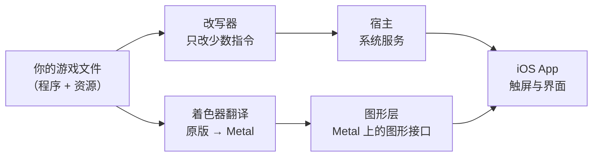

# D2R Mobile

**开源的《暗黑破坏神 II：狱火重生》术士君临 iOS / macOS 兼容层。** 把你自己购买的 Nintendo Switch 版游戏（含「术士君临」资料片）完整带到 iPhone、iPad 和 Mac 上：原版内核原生执行，整套操作为触屏重做，稳定 60 帧，一秒进局。现在也有原生的 macOS 版（第一版）：Apple 芯片的 Mac 上双击启动，键盘、鼠标、手柄都能用。

这不是一个「勉强能跑」的技术演示，而是一个打磨到可以天天玩、从开荒一路玩到终局的移动版。

平台：iPhone / iPad（iOS 26 起；iOS 18 – 25 用老接口版）· Mac（Apple 芯片，macOS 26 及以上；macOS 15 – 25 用老接口版）· 游戏版本：Switch 版「术士君临」1.0.34.0（对应 PC 版 3.3.94012）· 中文 / English · 许可证：MIT · **需要自备游戏文件**

English: [README.md](README.md)

<p align="center">
  
</p>
<p align="center">
  
  
</p>

| 满帧 60 fps | 续航 10 小时 | 一键符文之语 | 100 层大秘境 | 终局首领连战 | 1 秒进局 |
|:---:|:---:|:---:|:---:|:---:|:---:|
| 热机不掉帧 | 省电模式，一次充电 | 长按底材，符文一键全镶 | 技能上限 20 → 40 | 12 关，超级三首领压轴 | 主菜单到开打只要一秒 |

## 一句话复刻

备好游戏文件，然后对 Claude Code 或 Codex 说：

```
用 https://github.com/d2r-mobile/d2r-mobile 里的 d2r-mobile skill，帮我把 D2R Mobile 装到我的 iPhone 上。游戏文件在 <路径>。
```

它会检查你的电脑、准备工作区、签名装机，再把游戏资源拷进手机。只有两件事会停下来问你：Apple 签名信息，以及需要 `sudo` 的安装要不要做。skill 在 [skills/d2r-mobile/SKILL.md](skills/d2r-mobile/SKILL.md)，两个助手都会通过 `.claude/skills/` 和 `.agents/skills/` 自己找到它。想手动做，看下面的[开始使用](#开始使用)。

## 为什么玩起来像原生游戏

- **手机跑的就是原版程序。** iPhone 和 Switch 用同一类 ARM 处理器。改写器只改苹果内核不认的那几类指令（线程指针寄存器、系统调用、计时器），其余逐字节保持原样。职业、符文之语、恐怖地带、首领、掉落规则、任务流程和原版一样，因为它们就是原版代码。
- **图形直通 Metal。** 一个为苹果平台写的小型宿主提供游戏要的系统调用、文件、音频和输入，并在 Metal 上重新实现它的图形接口。着色器在构建时全部离线翻译，进新场景不用等现编。
- **旧芯片有自己的贴图。** A16 及更早的芯片不支持游戏原本的贴图压缩格式，构建时为它们另做一份补充贴图包，这些机型同样满帧。

## 仓库里有什么，你要带什么

仓库里有改写器、宿主、图形层、iOS App、测试工具和完整的构建流水线。没有游戏程序、美术、文字、数据表或着色器：这些都由你自己的电脑用你自己的文件现做出来（见 [docs/GAME_FILES.zh-CN.md](docs/GAME_FILES.zh-CN.md)）。我们为适配记录下的接口信息，比如着色器的接口描述、图形接口的函数表、程序内的地址，逐项列在 [docs/DERIVED.zh-CN.md](docs/DERIVED.zh-CN.md)。

游戏完全离线运行，不需要任何联网账号，不支持联机。

## 经过实战检验

内测的 **44 台** iPhone 与 iPad **全部用多个角色打通了普通、噩梦、地狱**：35 台登记设备（25 台 iPhone、10 台 iPad），加 9 个 TestFlight 账号各一台。最老的一台是 6 GB 内存的 iPhone 14 Pro Max，照样稳定 60 帧。

| | 机型 |
|---|---|
| iPhone | 14 Pro Max、15、15 Pro、15 Pro Max、16 Plus、16 Pro、16 Pro Max、17 Pro Max 等 |
| iPad | iPad Air、iPad mini、iPad Pro 11 寸与 12.9 / 13 寸（含 M2、M4）等 |
| 最低实测机型 | **iPhone 14 Pro Max（A16，6 GB 内存）：稳定 60 帧** |

iPhone 与 iPad 共用一个安装包。

<p align="center">
  
  
  
  
  
</p>

## 速度与续航

iPhone 17 Pro Max 实测：

| 项 | 读数 |
|---|---|
| 局内帧率 | **60 帧**，稳定，热机不掉帧 |
| App 启动 | 0.15 秒 |
| 到主菜单 | 约 1 秒 |
| 从主菜单进到局里 | **约 1 秒** |
| 一键重开，回到局里 | 约 1.2 秒 |
| 换幕时最长的一帧 | 约 0.1 秒 |
| 整机功耗，60 帧 | **约 3.8 W**（营地，亮度 50%），满电能玩近 5 小时 |
| 整机功耗，省电模式 30 帧 | **约 1.85 W**，满电能玩近 10 小时 |

<sub>测量条件：功耗为 2026-10-10 在 iPhone 17 Pro Max 上量的整机功耗，第一幕营地站立，亮度 50%，60 帧与省电模式同场景；续航由实测功耗与电池容量换算，不是从满电玩到没电。启动与入局时间为 2026-10 同机型实测；帧率与换幕为 2026-10-12 同机型进局后走图、换幕的读数。</sub>

安装包一百多 MB；游戏资源（约 5.6 GB）单独放进手机，升级 App 时存档和资源都不动。

之所以能这么快：程序是原生执行的，没有一条指令经过模拟；图形直接走 Metal；着色器全部离线翻译、预先编好，进新场景不用现编。旧机型（A16 及更早，如 iPhone 14 系列、iPhone 15）不支持游戏原本的贴图压缩格式，要用你自己的游戏文件另做一份贴图包，同样满帧——做法见 [docs/LEGACY_DEVICES.zh-CN.md](docs/LEGACY_DEVICES.zh-CN.md)。

每一个面板、每一种操作都按触屏重做过，原则只有一条：**沿用原版的界面语言，用手势代替往屏幕上加按钮**。字号和点击范围按手指大小设计。拿起来就会玩，玩久了也顺手。

<p align="center">
  
  
</p>

- **走**：摇杆移动，斜推方向精准；点 NPC、点地面自动寻路；门、传送门、洞口整扇都能点中。
- **打**：技能按钮按下就放、按住连放、**拖动朝任意角度瞄准**，附近有怪自动锁定。两组技能。副手技能一键放：自动换武器、放技能、换回来，按钮上显示剩余次数。
- **首领血条**固定在屏幕顶部，显示剩余百分比。
- **物品**：单击、双击、长按、拖放全部跟手。双击装备直接穿上或卸下，拖到商人面板任意位置就能卖；成叠物品双击取 1 个、长按取 3 个；长按背包空格一键整理。
- **文字**：用系统键盘输入，角色名可以用中文，留空随机取名。
- **屏幕**：iPhone 19.5:9 全面屏铺满，避开刘海和圆角；iPad 上游戏画面铺满整块屏幕，打开功能页时界面自动居中；3D 画面可加亮。

### 手柄

接上手柄、按任意键，界面换成原版手柄布局，每个面板底部带按键提示；碰一下屏幕，回到触屏界面。物品栏、储藏箱、技能树、编年史、设置页都能用手柄操作，键位与 Switch 一致。

<p align="center">
  
  
</p>

## 原版之上的终局

打通地狱，新的终局就开了。这些内容都不改原版规则。

### 大秘境

从哈洛加斯的红门进入。共 100 层，怪物逐层变强；15 分钟内攒满进度、打倒守护者即过关。每过 2 层 +1 技能点、+5 属性点，技能等级上限从 20 提到 40；每 10 层有首通奖励；打通 10 层解锁佣兵的六个新装备位。

<p align="center">
  
  
</p>

### 终局首领连战、极乐世界、刷怪积分牌

- **终局首领连战**：地狱通关后开启，共 12 关；第 11 关是暗黑克隆，第 12 关是超级三首领。
- **极乐世界模式**（建角时勾选）：暗金 ×5、套装 ×3、符文 ×5，「不掉落」的概率降到十分之一，首领每次都按首杀掉落。
- **刷怪积分牌**：每个首领的击杀次数、首杀时间、出了多少暗金与套装、最快和平均用时。

<p align="center">
  
  
</p>

### 仓库：给收藏党的

- **编年史仓库**：每件已鉴定的暗金、套装各有固定一格，所有角色共用，可搜索、存取；「存放」按钮一键把背包和魔盒里的暗金、套装收进去。
- **储藏箱**加宽到 14 列，个人仓库 5 页，共享仓库 5 页。
- **珍宝匣**：宝石、符文、材料三页合成一页，中间就是魔盒的合成格，找东西、做合成都在一页上。存进个人页或共享页的符文、宝石、材料会自动归到这里。
- **百宝囊**：扩展背包。野外捡到的符文、宝石直接进来，不占背包格。

<p align="center">
  
  
</p>

### 省心刷宝

| | |
|---|---|
| 符文之语助手 | 长按带孔底材，列出能做的符文之语和属性；符文齐了一键镶嵌 |
| 增益技能自动补 | 学了的增益技能不用摆在技能栏上：增益没了，你站定的那一刻自动补放；副手武器带的增益（如战争召唤）自动换手、补上、再换回 |
| 药水与腰带 | 自动喝药分两档：生命低于 50% 喝红药，低于 30% 喝紫药；**佣兵按同样规则喝药**。腰带有空位时自动捡起地上的药水；双击腰带空格一键补满 |
| 掉落过滤 | 进噩梦起自动启用原版的战利品过滤器，把杂物藏起来：噩梦轻筛，地狱重筛 |
| 自动拾取 | 低号符文和宝石自动收进百宝囊，高号的留给你亲手捡 |
| 高价值掉落提醒 | 高级符文和暗金冒光柱、换一个落地音，手机按价值震动轻、中、重三档 |
| 小地图指引 | 每张地图标出小站和出入口；所有任务终点上图；目标在画面外时贴着屏幕边写名字 |
| 省掉的琐事 | 鉴定免费、回城免费、进局直接落在传送小站旁、一键重开、商人货架可刷新 |
| 存档 | 切后台、划掉、退出都立刻存盘；iCloud 多设备同步（需要付费开发者账号签名） |

多数功能能在游戏里「选项 → 自定义」页逐项开关。

<p align="center">
  
  
  
</p>

### 中文与英文

整个游戏可在「选项 → 自定义」里切换为英文，重启后界面与语音都是英文：物品、技能、怪物名沿用原版英文，我们新增的内容（秘境、编年史、设置页、手柄提示）也都有英文。

<p align="center">
  
  
</p>

## 怎么做到的



| 部分 | 位置 | 做什么 |
|---|---|---|
| 程序改写器 | `dm/tools/patch_nso.py` | 只改写在苹果内核下不能原样执行的少数指令（线程指针寄存器、系统调用、计时器），程序其余部分逐字节保持原样 |
| 宿主 | `dm/host` | 装载改写后的程序，提供它调用的平台服务 |
| 图形 | `dm/gfx` | 在 Metal 上实现游戏用的图形接口；着色器由游戏原版离线翻译 |
| iOS App | `dm/ios` | App 外壳、触摸操作与界面 |
| 验证 | `dm/verify` | 核对改写后的代码与原版行为一致，以及每次改动都要过的回归闸门 |

**测试和代码一起开源。** 项目自带宿主与图形层的单元测试、对每一处改写指令的等价核对、触摸界面的脚本化走查回归、真机冒烟。从 `make -C dm/host/tests run`、`make -C dm/gfx/tests run` 与 `dm/verify/regress.sh` 开始（都在下面第 2 步准备的 Python 环境里跑；`regress.sh` 另需 `brew install llvm`）。怎么参与见 [CONTRIBUTING.zh-CN.md](CONTRIBUTING.zh-CN.md)。

## 支持哪些设备

| 设备 | 能不能玩 | 怎么做 | 把握程度 |
|---|---|---|---|
| **iPhone / iPad，A17 Pro 及以后**（iPhone 15 Pro 起、iPhone 16 起、M 系列芯片的 iPad） | 直接玩 | iOS 26 及以上用缺省的壳 / 缺省构建；iOS 18 – 25 用 iOS 18 的壳 / [老接口版](docs/OLDER_SYSTEMS.zh-CN.md) | 主力机型，日常在玩 |
| **iPhone / iPad，A16 及更早**（iPhone 14 全系、iPhone 15 / 15 Plus、iPhone 13 系列等） | 可以玩，多一步 | 按 [docs/LEGACY_DEVICES.zh-CN.md](docs/LEGACY_DEVICES.zh-CN.md) 用自己的游戏文件做一份老机型补充包，做安装包时带上它；系统同上一行分 iOS 26 / iOS 18 – 25 | 已有玩家实测：iPhone 14 Pro Max（A16，6 GB）60 帧；iPhone 13 Pro Max（A15，6 GB）30 帧档 |
| **4 GB 内存的设备**（如 iPad Air 第 4 代） | 暂不支持（在优化内存，有进展更新） | — | 已有玩家实测：iPad Air 4（A14，4 GB）带上老机型补充包后，启动几秒即因整机内存不足被系统结束 |
| **比 A15 更老的芯片、6 GB 及以上内存** | 尚无报告 | 同 A16 及更早那一行 | 欢迎试过的人开 Issue 告诉我们结果 |
| **Mac，Apple 芯片** | 直接玩（原生 macOS App） | macOS 26 及以上用缺省出法；macOS 15 – 25 用[老接口出法](docs/OLDER_SYSTEMS.zh-CN.md)。键盘、鼠标、手柄都能玩，各自能做什么见 [docs/MAC.zh-CN.md](docs/MAC.zh-CN.md) | 已有玩家在 macOS 15.7.7 上实际玩过老接口版 |
| **Intel 芯片的 Mac** | 不支持 | — | — |

**App 里弹的框是什么意思**

- **「这台设备要多做一步」**：这台手机可以玩，只是做安装包时没有带上老机型补充包。照 [docs/LEGACY_DEVICES.zh-CN.md](docs/LEGACY_DEVICES.zh-CN.md) 做好补充包、带着它重新做一次安装包再装，就能进游戏。
- **「暂不支持本机型……iPhone 15 Pro 及以后可以玩」**：这是 v1.0.9 以前的旧文字。用的是旧版本，更新到最新版本即可；A16 及更早的机型照上一条做。

**自己做的包和我们内测包的差别**：公开版可以用免费的 Apple ID 自己做包、自己装。内测包里有三样公开版没有：iCloud 存档同步（需要 App 带着 iCloud 的签名权限，自己签的包没有）、App 内下载补充包与资源、新版本提醒（这两样要用到我们自己的服务端）。游戏本身和我们加的玩法两边一样。

## 开始使用

两条路都要先有**你自己购买的游戏的文件**：Switch 版《暗黑破坏神 II：狱火重生》本体加「术士君临」资料片，更新到 1.0.34.0（主机上显示的版本号；它对应 PC 版的 3.3.94012，本仓库的目录名和工具里用的是后一个号）。本项目是按带这部资料片的版本做的，没有资料片的情况不支持、也没有验过。怎么准备见 [docs/GAME_FILES.zh-CN.md](docs/GAME_FILES.zh-CN.md)。

> 本项目只提供工具与不含任何游戏内容的安装壳。我们不提供、不认可、也不对任何第三方分发游戏资源、游戏主程序或含游戏内容的安装包的行为负责。请只使用你自己合法拥有的游戏文件。

本项目基于 Switch 版 1.0.34.0（对应 PC 版的 3.3.94012）实现并验证，工具默认只认这一版。已有社区用户反馈，参照仓库结构自行适配了其他版本并成功运行。规则表按游戏版本分组存放（`dm/tools/patch_nso.py` 里按主程序的构建标识分组），欢迎把你适配的版本提交回来。

**先对一下你的设备**：上面「支持哪些设备」那张表告诉你该用哪种构建、要不要多做一份老机型补充包。

| | 有 Mac | 没有 Mac |
|---|---|---|
| 电脑 | Apple 芯片的 Mac，装好 Xcode | Windows / Linux / 没装 Xcode 的 Mac |
| 做法 | 从源码完整构建 | 下载不含游戏内容的「壳」，用工具把你的游戏内容做进去，再用自签工具装机 |
| 现状 | 主路，上面的数字都出自它 | Windows 上从做包到真机游玩整条走通，两个系统做出的游戏程序逐字节相同；用自签工具签名这一步还没人试过，欢迎反馈 |
| 说明 | 下面三步 | [docs/NO_XCODE.zh-CN.md](docs/NO_XCODE.zh-CN.md) |

签名用的 Apple 账号：付费开发者账号功能最全；免费 Apple ID 也行，只是没有 iCloud 存档同步，每 7 天要重新签名重装。完整的依赖清单见 [docs/DEPENDENCIES.zh-CN.md](docs/DEPENDENCIES.zh-CN.md)。

最快的路是[一句话复刻](#一句话复刻)：让你的 AI 助手替你跑完下面的步骤。

### 有 Mac：三步

1. 把游戏文件放进工作区（缺省 `~/dm-work`，或设 `DM_ROOT`）：

   ```
   ~/dm-work/data/switch/3.3.94012/Update/ExeFS/    main、sdk、subsdk0
   ~/dm-work/data/switch/3.3.94012/Update/RomFS/    data/…
   ```

2. 准备工作区。这一步检查工具、改写游戏程序、把游戏的着色器翻译成 Metal。第一次约 11 分钟，之后已做过的步骤会跳过。

   ```
   ./setup.sh
   source ~/dm-work/build/cache/dm/venv/bin/activate     # 之后的命令都在 setup 准备好的 Python 环境里跑；换过 DM_ROOT 的话把 ~/dm-work 换成它
   ```

3. 填好签名信息，出 App：

   ```
   cp dm/ios/local.env.example dm/ios/local.env     # 填 DM_TEAM_ID 与 DM_BUNDLE_ID；免费 Apple ID 另填 DM_FREE_ACCOUNT=1 与 DM_IOS_UDID，构建时手机连着
   cd dm/ios && ./run.sh build    # 缺省同时面向 iPhone 与 iPad；只要 iPhone：DM_DEVICE_FAMILY=1 ./run.sh build
   ```

装到手机上第一次打开，App 会要「游戏资源文件夹」，也就是游戏文件里的 18 个资源档案。怎么放见 [docs/GAME_FILES.zh-CN.md](docs/GAME_FILES.zh-CN.md) 的「手机上要放的那个游戏资源文件夹」一节。

`./setup.sh check` 是体检：逐项报告这台电脑、工具、游戏文件、签名配置的状态，缺的每一项都给出去哪拿和下一步命令，不做任何改动。手上是一整个游戏包（`.xci` / `.nsp`）时，`./setup.sh <游戏包> <prod.keys>` 会先把游戏文件取出来放到位再接着准备（要先装 hactool）。每次拉了新提交都再跑一遍 `./setup.sh`：它按当前源码重出改写产物与着色器库，已是最新的步骤会跳过。它还会改写仓库里三个随工具指纹变化的文件（`dm/gfx/tools/dmsh_chain.lock`、`dm/gfx/nvn/dmsh_chain.h`、`dm/gfx/nvn/c1_full.tsv`），这是预期的，不要提交它们。

### 在 Mac 上直接玩

同一份 `./setup.sh` 做完之后，再跑一条命令就能出一个原生的 macOS App，双击启动，键盘、鼠标、手柄都能用，不需要开发者账号：

```bash
source ~/dm-work/build/cache/dm/venv/bin/activate
dm/tools/mac_app.sh                  # macOS 26 及以上：产出 ~/dm-work/out/macapp/D2R Mobile.app
DM_MAC_M3=1 dm/tools/mac_app.sh      # macOS 15 – 25：产出 D2R Mobile M3.app
```

界面用原版的手柄版界面。键盘：空格确认、Esc 返回、回车、`=` 键开菜单 / 新角色，W A S D 移动，其余手柄键各有对应。鼠标：点怪、NPC、物件会走过去交互，底部的技能格、药水格、按键提示、面板里的按钮和页签、建角时的职业、小地图都能点；点空地会走过去、按住一直走，点怪是攻击，物品的双击和拖放也认鼠标。用键盘时屏上的按键提示直接显示键盘键名。存档在这台 Mac 上（自己构建的 App 没有 iCloud 同步），可以从 iPhone / iPad 手工导入。键位表、建角怎么按、鼠标能做什么、导入步骤和已知不足，见 [docs/MAC.zh-CN.md](docs/MAC.zh-CN.md)。键盘、实体手柄这几项还未经真人操作，你试过的话，请告诉我们结果。

### 没有 Mac：壳 + 做包工具

从本仓库的[发布页](https://github.com/d2r-mobile/d2r-mobile/releases)下载我们预先做好的、不含游戏内容的「壳」安装包（`D2RMobile-shell.ipa`；iOS 18 – 25 用 `D2RMobile-shell-ios18.ipa`），加上你自己的游戏文件，在 Windows 或 Linux 上做出安装包，再用自签工具签名装机。只有走这条路时，因为做包的电脑上没有苹果的着色器编译器，手机**第一次启动**要花约 7 分钟把着色器编完（一次性，带进度条）；用 Xcode 构建的包没有这一步。步骤与每一步的验证现状见 [docs/NO_XCODE.zh-CN.md](docs/NO_XCODE.zh-CN.md)。

## 已知限制

| 项 | 现状 |
|---|---|
| 联机 | 不在范围内，完全离线 |
| `.nsp` / `.xci` 两种游戏包 | 工具只核对主程序的版本，不区分包的格式；我们自己用 `.xci` 走过全程，有网友反馈 `.nsp` 格式的游戏包也完美兼容 |
| 用自签工具（Sideloadly、AltStore 等）签名装机 | 没验过，欢迎开 Issue 告诉我们结果 |
| Linux 上做包 | 没验过（Windows 与 Mac 上验过） |
| 没升到 iOS 26 / macOS 26 的设备 | 可以玩，用老接口版（最低 iOS 18.0 / macOS 15.0）：[docs/OLDER_SYSTEMS.zh-CN.md](docs/OLDER_SYSTEMS.zh-CN.md)；完整的设备表见上面「支持哪些设备」 |
| A16 及更早的机型（iPhone 14 系列、iPhone 15 / 15 Plus 等） | 可以玩，要多做一份老机型贴图包并带着它构建 App：[docs/LEGACY_DEVICES.zh-CN.md](docs/LEGACY_DEVICES.zh-CN.md)。App 提示「这台设备要多做一步」（旧版本显示的是「暂不支持本机型」）就是缺这一步 |
| 物品注释里的「一句点评」与「旧译名对照」 | 两张内容表不随仓库提供，可自备，见 `dm/ios/tools/annot/README.zh-CN.md` |

## 参与与反馈

- 遇到问题请开 Issue（有模板）；能附上暂停菜单里「分享诊断日志」导出的文件最好。
- 没验过的那几项，走通或走不通都请告诉我们。
- 想改代码：先跑通上面的测试入口，每次改动都要过回归闸门。

**往别的平台走：** 这套做法不限于 iPhone 和 iPad。Apple 芯片的 Mac 已经有了原生版本（见上面「在 Mac 上直接玩」），用的是同一份游戏程序和同一个宿主。安卓手机用的是同一类处理器，游戏程序同样可以原生执行，这条路完全走得通：要换的只是宿主和图形层对接的那一侧。作者手边没有安卓手机，非常期待看到有人把它带到安卓上。

**往别的游戏走：** 已经有人拿同一份宿主去试别的 Switch 游戏。宿主里有一些「iOS 上缺省就开」的行为是为这一个游戏写的，换游戏会先撞到它们，动手前先关掉或挪走：

- `dm/host/hle_oe.c`：三维渲染比例在 iOS 上缺省 0.75，`scale3d_tick` 按这个游戏渲染器里的偏移去改写——换一个游戏，那就是个野指针。
- `dm/host/hle_fs.c`：首次启动预置共享仓库（`DM_STASH_SEED`）与触屏版缺省设置（`DM_TOUCH_DEFAULTS`），iOS 上缺省开。
- `dm/host/main.c`：存档落盘节流改的是游戏程序里一个固定地址上的常数；`argv[0]` 写死成 `"D2R"`。
- `dm/host/hle_time.c`：固定时刻的测试开关认的是游戏程序里的一个固定地址。
- `dm/host/front_mac.m` 的 `front_game_res`：底座 / 掌机两档分辨率写死成 1600×900 / 1280×720。
- `dm/host/dm_cloudsync.c`：按 `.d2s` 认角色目录。
- `dm/host/dm_cursor.c`、`dm/host/dm_world.c`：整个文件都是这个游戏专属的。

更干净的做法是把这些缺省值挪进各游戏自己的配置，宿主里不带游戏专属的缺省；欢迎朝这个方向提合并请求。

## 各部分的说明

| 说明 | 讲什么 |
|---|---|
| [dm/README.zh-CN.md](dm/README.zh-CN.md) | 整套东西怎么工作、目录、常用命令、宿主各文件 |
| [dm/gfx/README.zh-CN.md](dm/gfx/README.zh-CN.md) | 图形层与着色器翻译链 |
| [dm/ios/README.zh-CN.md](dm/ios/README.zh-CN.md) | iOS 外壳、出包与冒烟 |
| [dm/verify/README.zh-CN.md](dm/verify/README.zh-CN.md) | 验证工具各自验什么、需要什么前提 |
| [docs/GAME_FILES.zh-CN.md](docs/GAME_FILES.zh-CN.md) | 游戏文件：要哪些、怎么从自己的主机取、放到哪 |
| [docs/DEPENDENCIES.zh-CN.md](docs/DEPENDENCIES.zh-CN.md) | 依赖清单与第三方许可证 |
| [docs/NO_XCODE.zh-CN.md](docs/NO_XCODE.zh-CN.md) | 不用 Xcode、不用 Mac 的做法 |
| [docs/MAC.zh-CN.md](docs/MAC.zh-CN.md) | 在 Mac 上玩：构建 macOS App、键位、已知不足 |
| [docs/LEGACY_DEVICES.zh-CN.md](docs/LEGACY_DEVICES.zh-CN.md) | 老机型（A16 及更早）：怎么做贴图包、怎么放进手机 |
| [docs/OLDER_SYSTEMS.zh-CN.md](docs/OLDER_SYSTEMS.zh-CN.md) | 老系统（iOS 18 – 25、macOS 15 – 25）：老接口版怎么出、和老机型贴图包怎么组合 |
| [docs/qa-rift-pet-life.zh-CN.md](docs/qa-rift-pet-life.zh-CN.md) | 大秘境随从生命的回归清单（哪些跑过、哪些还没人跑，欢迎补） |
| [docs/DERIVED.zh-CN.md](docs/DERIVED.zh-CN.md) | 仓库里与游戏有关的东西：有什么、没有什么、为什么 |

## 声明

**你必须拥有正版游戏，包括「术士君临」资料片。** 这是一个独立的非商业项目，与暴雪娱乐、任天堂没有关联，也未获其认可或赞助。Diablo 与 Blizzard Entertainment 是暴雪娱乐的商标，Nintendo Switch 是任天堂的商标。请只配合你自己拥有的游戏使用。

## 许可证

MIT，见 [LICENSE](LICENSE)。第三方代码各自的许可证在其目录内，见 [docs/DEPENDENCIES.zh-CN.md](docs/DEPENDENCIES.zh-CN.md)。

装好能玩的话，点个 ⭐，让下一位玩家找得到它。
